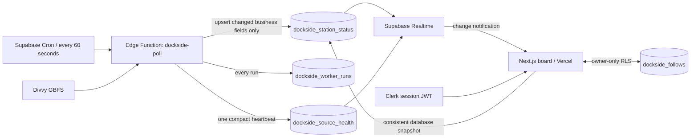

# Dockside

A live Divvy station board for getting a bike near your starting point or finding an open dock near your destination. Covers **24 docked stations around UChicago / Hyde Park and 16 in the Loop**.

**App:** https://dockside-chi-eight.vercel.app

**Repository:** https://github.com/DarryDarius/Design-Build-Ship---Assignment-5

Built for MPCS 51238, Design, Build, Ship — Assignment 5.

## Use it

1. Choose **Get a bike** or **Return a bike**.
2. Set your starting point or return destination. Choose a preset place, a monitored station, or explicitly share your device location.
3. Compare live quantities and straight-line distances. “Nearest available” requires fresh data and the matching rental/return service flag.
4. Open a station for details, nearby alternatives, and an external Google Maps route.
5. Use a star to save your everyday stations. Clerk sign-in preserves the selected task and pending save. **My stations** contains only your choices.

The board works publicly; personal saves require sign-in. The coverage control explains the monitored area. Station search spans both neighborhoods, labels each result’s area, and opens cross-area results in that area. The location picker searches presets and monitored stations; it explicitly explains that arbitrary street addresses and other buildings are unsupported.

## Product and design

Dockside uses the visual language of civic wayfinding: cobalt blue, a restrained station index, aligned availability numbers, compact typography, and continuous rows. The primary heading and information change with the task. The first fresh snapshot selects the nearest eligible stop; a compact recommendation shows its quantity and straight-line distance. Manual selections and later live updates keep the detail panel stable. Phone layouts use a station-detail sheet with focus management; desktop layouts put the same details beside the list.

- Return searches center on the **destination**, rather than automatically using the rider's current location.
- Bicycle totals come from GBFS vehicle types. Scooters are excluded.
- Open docks come directly from the source; they are not inferred from capacity minus bikes.
- Low inventory has a text explanation. Old or missing data never becomes a fake zero.
- Live changes update numbers without shuffling the list or stealing focus.
- Distances are straight-line distances. Google Maps provides the actual route.
- Device coordinates stay in browser memory and are not saved to the database or browser session storage.

The pre-implementation product specification and data-flow chart are in [docs/PRODUCT.md](docs/PRODUCT.md), included in the initial commit before application implementation.

## The live system



The worker is a short-lived TypeScript function on Deno. Cron calls it while the website is closed. It validates the response, normalizes boolean and numeric service flags, identifies bicycle types, and passes the 40 monitored station records to a transactional database function. PostgreSQL uses `IS DISTINCT FROM` to update only changed availability/service fields. A repeated response records a successful run with zero changed rows.

Every run has a result, timestamps, duration, read/changed/missing counts, and a sanitized error code. A startup lease avoids overlapping work; abandoned runs are marked timed out. Detailed run records are retained for seven days. Inventory, health, and the completed run are committed together.

Cron authenticates with a dedicated random `x-dockside-token` secret stored in Supabase Vault and Edge Function secrets. The function rejects public keys and ordinary user tokens. Its Supabase service credential is supplied by the platform and never sent to the browser.

The page reads an initial consistent database snapshot and subscribes to Postgres Changes for the active station scope plus source health. It reconciles again after subscribing, on reconnect, and on returning to the tab. Bursts are coalesced. Normal production updates are pushed through Realtime; there is no recurring browser poll of Divvy.

## Freshness and failure states

| State | Meaning and behavior |
| --- | --- |
| Loading | Structured placeholders; unknown quantities are never displayed as 0 |
| Fresh | Recent successful ingestion and recent source data |
| Stale | Worker/feed freshness exceeds 180 seconds, or the individual station's report exceeds 300 seconds |
| Down | The worker's latest completed attempt failed; keep clearly labelled last-known values |
| Missing station | Preserve the old record and mark it unconfirmed rather than inventing zero inventory |
| Browser offline/reconnecting | Explain the local connection interruption; do not call it a worker outage |

An unchanged quantity can remain fresh. The source heartbeat records the latest successful check, feed time, and per-station report times separately from business changes. Unconfirmed/stale/down stations are excluded from current availability suggestions.

## Identity and access

Clerk is configured as a Supabase third-party issuer. Its session tokens include `role: authenticated`. Supabase policies compare `user_id` to `auth.jwt()->>'sub'`.

- Station directory, current availability, and sanitized health: public read-only.
- Personal follows: authenticated owner-only select, insert, and delete. Ownership is checked by the database, and `(user_id, station_id)` is unique.
- Worker writes and internal run logs: service role only.
- Browser configuration contains only publishable keys.

All database objects are prefixed `dockside_`. The deployed Supabase project is independent of Assignment 4.

## Stack and source

Next.js 16, React 19, Tailwind 4, Clerk 7, Supabase Postgres / Realtime / Cron / Edge Functions, Vercel. Deno function sources are excluded from the Next.js TypeScript project.

- [Divvy data and license](https://divvybikes-marketing.lyft.net/system-data)
- [Official GBFS discovery](https://gbfs.divvybikes.com/gbfs/2.3/gbfs.json)
- [GBFS v2.3 specification](https://github.com/MobilityData/gbfs/blob/v2.3/gbfs.md)
- [Actual two-sample source check](docs/SOURCE-CHECK.md)

## Local development

```bash
npm ci
npx clerk@latest auth login
npx clerk@latest link --app app_3LZdI4hX9FAYTYxKV77FivFfmv7
npx clerk@latest env pull
```

Add the two public Supabase values listed in `.env.example`, then:

```bash
npm run dev -- --port 3005
```

The live cloud schema and worker are already deployed. Do not replay creation migrations on the existing project. Fresh-project setup and credential handling are described in [docs/OPERATIONS.md](docs/OPERATIONS.md).

In development only, a missing Supabase configuration enables an explicitly labelled direct-source preview. This preview has no background worker or personal persistence. **Production never silently falls back to this preview.**

## Validation

```bash
npm test
npm run typecheck
npm run lint
npm run build
```

`tests/unit` uses real saved GBFS responses with a pinned source clock. It checks deduplication, single-station changes, scooters, missing rows, bad fields, service flags, independent freshness, and borrowing/returning decisions.

For the configured owner account:

```bash
npx supabase@latest db query --remote=qhoubpcpelxruxnbgead \
  --file tests/database/invariants.sql --yes --output json
node scripts/verify-realtime.mjs
node scripts/verify-auth.mjs
```

The SQL checks roll back every test write. The auth verification uses two synthetic accounts in the Dockside development instance, real Clerk-signed JWTs, owner operations, cross-user attacks, and cleanup. Verification sessions are revoked. The realtime verification receives a real database event after invoking the real worker.

Project-scoped MCP has also been connected and used to query the database, deploy the worker, and set its schedule. Evidence: [MCP](docs/mcp-verification.json).

Detailed checklist: [Verification](docs/VERIFICATION.md). Evidence: [Realtime](docs/realtime-verification.json), [Clerk/RLS](docs/auth-verification.json). See [docs/LEARNING.md](docs/LEARNING.md) for field explanations, tracing an update, run-log interpretation, and classroom questions.

## Free-tier budget

At 60 seconds per run, 30 days is approximately **43,200 Edge Function calls**, before manual tests, against the current 500,000-call free allowance. Only 40 stations are monitored; unchanged business rows are not rewritten. Realtime is scoped and run history is bounded. Message fan-out and egress still depend on active viewers; monitor the Supabase usage dashboard.

Supabase's current free limits include a 500 MB database and two million Realtime messages per month. Free plans impose limits; no payment method or paid upgrade was added for this project. Keep the project available until grading is complete. Check current quotas in [Supabase pricing](https://supabase.com/pricing).

## User feedback and current limitations

The Nov 3 [usability review and iteration record](docs/USER-FEEDBACK.md) tracks reported issues and changes. Local-only guest saves and arbitrary address search remain future work. The web deployment is public; Clerk still uses a development instance. Moving identity to a production instance requires a production domain and DNS setup, production credentials, and an updated Supabase trust configuration. The development badge has not been cosmetically hidden.

## Human acceptance

On November 3, the project owner reported that a real classmate tested Dockside on November 2, 2026, signed in, saved stations, and observed a genuine update without refreshing. The reported overall feedback was “非常满意” (“very satisfied”). This is an owner-reported trial; the agent did not independently observe it. See the [trial record](docs/CLASSMATE-TRIAL.md).

See the [Assignment 5 audit](docs/ASSIGNMENT5-AUDIT.md) for requirement-by-requirement results, completed MCP follow-up, and classroom preparation notes.
