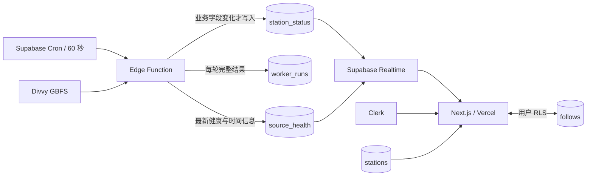

# Assignment 5 — Dockside 产品与实施方案

状态：执行前方案，2026-11-02。仅完成调研与规划，尚未创建应用或修改云端资源。

## 1. 产品定义

暂定名 **Dockside**。面向在芝加哥使用 Divvy 的学生，帮助用户在出门或抵达目的地前，选择一个当前可借车或可还车的站点，并找到附近替代站。

核心任务：选择借车/还车 → 确定出发点/目的地 → 比较附近站点 → 打开路线；登录后保存常用站点，之后直接检查。

首版采用英文 UI，符合芝加哥同学的试用场景；开发文档及学习说明可使用中文。保持语言、时间和距离单位一致。

### 产品原则

- 可用性先于原始数据量；站名、对应任务的数量、距离、可信程度共同支持决定。
- 借车围绕出发点；还车围绕目的地。还车时“使用我的位置”只是一种可选的目的地设置方式。
- 登录发生在保存个人关注时；公共站况无需先注册才能查看。
- 状态来源可解释，不预测抵达时是否有车，不将变化当成趋势。
- 后台变化时更新数值，保持列表顺序、选择和键盘焦点稳定。

## 2. 对 Assignment 4 的具体改进

基于 TodayView.tsx、Landing.tsx、Nav.tsx、globals.css 和 flows.md 的审阅：旧作品使用暖纸色、Fraunces、居中窄栏、大标题、说明文案及独立 Today/Shelf/Log/Week 页面。页面状态处理已有基础，但用户仍需自行串起多页操作。

Dockside 从实际决策组织首页，借还模式改变信息优先级和有效性判断；站点浏览、比较、详情、保存围绕一个工作界面展开。视觉转为城市导向牌和公共信息板：明确的列、数字、站名、编号及分隔线，建立与交通任务一致的识别。

## 3. 范围与覆盖

- 首版监测约 40 个固定站点，覆盖 Hyde Park 与 Loop 两片明确标示的区域。
- 实施时依据实际站点坐标、分布、数据质量，选择约 24 个 Hyde Park 和 16 个 Loop 站点；保存可审阅的覆盖清单。临时停用、无车或上报延迟不会使已纳入站点从界面悄然消失。
- 搜索范围为这些站点及少量已校验的预设地点，提示“Search monitored stations or preset places”。不将其包装成任意地址搜索。
- 用户地理位置仅在主动点击时请求，用于本次距离计算；默认保留在浏览器内存，不写数据库。
- 默认参考点为清晰标出的校园预设地点，可切换 Loop、选择站点为参考点或使用当前位置。
- 位置在覆盖区外时直接说明覆盖范围，并提供切换覆盖区的入口，不推荐相距数公里的“附近站点”。

## 4. 页面与主要流程

### 主界面 `/`

- 紧凑顶部：Dockside、Chicago、登录/账户；无大型营销首屏。
- 任务条：`Get a bike / Return a bike`。
- 位置条：借车为 `Starting near`；还车为 `Returning near`。分别记住两种模式的上次参考点，切换时明确显示。
- 借车可选 `Any bike / Classic / E-bike`；还车突出空桩，不保留无关车型筛选。
- 切换 `Find stations / My stations`。未登录点击 My stations 时解释其用途并提供登录入口，仍可继续浏览公共站况。
- 主区为站点信息板；桌面详情与附近替代位于右侧。手机为单列，详情使用可返回、可关闭的底部面板，保留列表位置。
- 系统健康为简短、可展开的信息条，正常时弱化，异常时明确解释。

### 首次使用

打开即看到校园覆盖区的真实站况 → 选择借车/还车 → 确定参考点 → 比较最近可用站点 → 展开详情 → 打开外部地图路线。

### 保存站点

点击 Save → 已登录则写入个人关注 → 未登录则进入 Clerk → 登录后恢复原模式、参考点和站点，再完成保存。保存结果以数据库响应为准；失败保留上下文并允许重试。重复点击不得产生重复关注。

### 返回使用

有关注的用户优先看到 My stations；每个站点展示当前任务所需数量与状态。My stations 的顺序稳定；距离是参考信息，不悄然调整用户列表。无关注时直接提供可保存的真实站点，不把用户留在空白页。

### 选中站点不可用

保留它的位置与选中状态 → 解释是无车、无桩、服务关闭还是数据不可靠 → 详情提供距离该站较近、符合当前任务的替代站 → 选中替代站并打开路线。

## 5. 站点信息与选择规则

### 行内信息层级

1. 站名与当前任务数量，例如 `07 bikes` / `04 open docks`。
2. 直线距离、车型明细或对应服务状态。
3. 数据可信程度、保存控件；选中后展开最近变化和详情。

UI 中必须显式标注直线距离；通过外部地图提供实际路线，不由直线距离生成假步行时间。

### 借车有效性

必须安装中、允许租借、所选自行车类型数量 > 0，并有足够新鲜的数据。按 vehicle_types 的 form_factor 与 propulsion_type 判断自行车类型；不把滑板车混入自行车总量。

### 还车有效性

必须安装中、允许还车、num_docks_available > 0，并有足够新鲜的数据。空桩直接读取源字段，不用容量减车辆数计算。若源提供兼容性约束则遵守；未知情况不给兼容保证。

### 比较规则

- Find stations 按参考点的直线距离稳定排序；对当前有效站点中最近的一个标出 `Nearest available`。
- 1–2 辆车/空桩标注 `Only 1 left` / `Only 2 left`；这是当前余量提示，不代表成功概率。
- 优先显示约 1 km 内的候选；不足时由用户明确扩大到覆盖范围内更多站点。
- 没有可靠候选时说明原因，提供更改参考点、扩大范围或更换车型等对应动作。
- Realtime 改变数量及可用标签，不让行跳动；用户主动改变参考点或排序条件时才重新排序。
- “最近变化 +2”来自两次真实记录对比，注明发生时间；刷新页面后的初始值不伪装为刚刚发生的变化。

## 6. 视觉与交互规则

方向：城市导向牌 / 站点信息板。工作名称 Dockside，使用原创字标和信息排版。

- 背景为接近白的浅灰；主体深墨色；钴蓝用于任务选择、当前站点和主操作；琥珀用于低余量或延迟。服务状态始终配文字或符号。
- 字体使用清晰的无衬线，数字启用等宽数字；站名和数量形成强层级。避免把装饰性超大标题放在实用内容之前。
- 站点使用连续行与细分隔线；容器小圆角，减少阴影。大数字属于具体站点，不放无助于决策的全城 KPI。
- 桌面约 2/3 信息板、1/3 详情；窄屏首先显示任务、参考点与候选站点。
- 数字真实更新时局部短暂高亮；不全页闪烁、不每次刷新弹 toast、不重复向读屏播报整表。遵守 reduced-motion。
- 触控目标至少 44px；完整键盘支持；颜色之外有状态文字；数字更新不夺取焦点；详情关闭后焦点回到原行。

需要在实施第一阶段验证桌面及手机两种布局，后续功能沿用同一套组件和信息层级。

## 7. 数据新鲜度与异常

四种基础状态由采集健康、源更新时间和站点上报质量共同决定；浏览器连接状态单独表达。

| 情况                                 | 用户表达与行为                                                                     |
| ------------------------------------ | ---------------------------------------------------------------------------------- |
| 首次加载                             | 保持信息板结构的骨架；未知数量用占位符，绝不填 0                                   |
| 正常                                 | `Checked 24s ago · Source updated 38s ago`；展开查看确切时间                       |
| 数量未变                             | 正常保持 fresh；可显示 `No availability change in the last check`                  |
| worker 最近一次失败                  | down：提示最近检查失败、最后成功时间；保留旧数值并标明过期，不将其用于当前可用推荐 |
| worker/源超过 3 个预期周期无新鲜确认 | stale：提示数据延迟；即使 HTTP 200，也不能把陈旧 feed 标成 fresh                   |
| 个别站点上报延迟                     | 只标记该站点；其他站点仍按各自质量工作                                             |
| 站点缺失                             | 从完整、有效响应中确认缺失后标记 unavailable/unknown，不改成车数 0                 |
| 浏览器离线或 Realtime 断线           | 提示此设备停止接收更新；不直接归因于 worker 宕机                                   |
| 恢复连接                             | 重新订阅并读取最新快照，补齐断线期间变化                                           |

以 60 秒采集周期为基础，worker/源 stale 初始阈值 180 秒；站点 last_reported 初始保守阈值 300 秒，实施时结合覆盖站点抽样校验。阈值统一配置；站点长时间不变化与长时间不上报是不同概念。

对本次调研样本的观察：部分站点尽管服务标志开启，last_reported 仍很旧。因此源 feed 更新不能替代单站数据质量判断。

## 8. 系统与数据结构

### 数据表

- `stations`：源 station_id、名称、坐标、capacity、覆盖区域、是否纳入监测、可用的外部链接。保存固定覆盖清单。
- `station_status`：按类型的自行车数量、空桩、installed/renting/returning、最近业务变化时间与变化前后值、记录版本/本轮标识。业务快照仅在实际字段变化时更新。
- `follows`：Clerk user_id、station_id、created_at。唯一约束 `(user_id, station_id)`；个人读写策略同时验证用户身份，杜绝修改 user_id 冒领记录。
- `worker_runs`：开始/完成时间、结果、HTTP 状态、读取/比较/变化/缺失数量、耗时、源更新时间、精简错误码。详细记录不开放给公共浏览器。
- `source_health`：单数据源的最新运行结果、最近成功时间、源更新时间、最新有效轮次，以及监测站点的精简上报时间/缺失信息。每轮更新一个紧凑健康记录，避免为了心跳改写全部站点。

### worker

- 代码在 `supabase/functions/`；默认每 60 秒触发，依据响应 TTL 处理，不使用长期循环或浏览器驱动的采集。
- 每次调用记录一轮结果；超时、429、非 JSON、结构异常均有可识别记录。运行锁避免重叠采集；跳过也记录原因。
- 响应校验后按 station_id 匹配；车型信息来自同一 GBFS 源的 vehicle_types，名称与坐标来自 station_information。
- 首次/必要时刷新元数据，随后低频校验。实时站况每轮获取，只处理固定监测范围。
- 事务内比较并 upsert 实际发生变化的业务行，连同本轮健康结果一致提交；重复处理同一样本不制造重复变化。
- metadata 时间改变不计为库存变化；raw last_reported 的每轮更新放在紧凑健康信息中，以便判断单站新鲜度。
- 采集的时间戳需检查明显倒退或未来异常，前端按版本避免旧事件覆盖较新的快照。
- 保留最近 7 天详细运行记录，避免长期累积超过免费数据库容量；成功/失败累计数可在健康记录保留。

### 前端与权限

- 初次使用数据库快照；建立订阅后再做一次对账，避免快照与订阅之间漏更新。
- Realtime 表加入 publication，并验证 SELECT grants、RLS、Clerk token 三部分。只订阅当前屏幕所需站点和一条健康记录。
- 公共站点资料、快照、精简健康只读；个人关注仅本人读写；站点和健康仅 worker 写入。
- secret key 仅在 Supabase 服务端；定时调用须正确认证，不能把关闭 JWT 验证当作免鉴权。前端只含 publishable key 和用户 token。
- Clerk 登录状态改变时更新 Realtime 身份并清理旧订阅；退出登录清理个人状态。
- `tsconfig.json` 排除 `supabase`，区分 Deno worker 与 Next.js 的构建检查。

## 9. 范围优先级

必须交付：借还任务、明确参考点、固定站点搜索与距离、真实车型数量、站点详情及替代站、登录与个人关注、真实 Realtime、完整状态、样本测试、部署与文档。

完成主要链路后增强：更好的邻域切换、视觉过渡、分享当前站点的 URL、更细致的变化解释。

后续版本：应用内地图、历史分析、更多覆盖区域及通知。首版的路线动作使用外部地图，保证功能闭环。

## 10. 执行顺序与验收

1. 在 assignment5 中创建独立项目及仓库；复用 Assignment 4 经验证的认证/权限思路。确认已有 Supabase 免费项目数量和可用连接，再选独立项目或在现有项目中使用隔离命名；不触碰旧作业的数据和部署。编写 AGENTS.md、数据流图、覆盖清单和设计 tokens。
2. 先完成一个真实站点信息板切片，验证桌面及手机的布局、任务切换与信息层级；任何静态测试数据只在开发/测试中标识使用。
3. 部署采集链路，先手动执行验证，再设置定时；运行 fixture 测试并查看最近三次运行日志。
4. 接通快照、Realtime、恢复对账及 freshness；确认数据未变也显示 worker 正常运行。
5. 完成登录后的关注保存、跨设备读取和用户隔离验证；完成任务相关的搜索、替代站与路线入口。
6. 验证真实故障、浏览器断线及恢复；部署 Vercel，邀请一位同学亲自完成登录、选择关注、观察自动更新。
7. 完成 README、关键设计取舍、运行日志说明、测试说明、免费额度预算和课堂讲解。提交 Vercel/GitHub URL，保留反映实际阶段的提交历史。

### 必要验证

- 同一样本处理两次：第二次业务 changed_count 为 0；每轮仍有运行记录。
- 一个站点数量改变：只更新该站业务快照；车型汇总不包含 scooter。
- 源数据过期但 HTTP 200：显示 stale；单站上报过期不被全局成功掩盖。
- 源失败、缺失站点、异常数量/字段：保留旧值且解释原因，不伪装为零库存。
- 两个真实用户：可关注同一站点，但不能查看或修改对方关注；未登录不能写入。
- 首次登录保存意图得以恢复；失败不会误报保存成功。
- worker → DB → Realtime → 已打开页面真实更新，无整页刷新；断线后自动对账。
- 窄屏、键盘、定位拒绝、覆盖区外、低余量、无可靠候选均有完整可操作状态。

### 体验目标（待实测，非已达成）

首次访问者无需解释，能在约 20 秒内找到一处与当前任务相符的站点并打开路线；返回用户能在约 5 秒内辨认常用站点是否适用。进入页面即可看到任务和真实站况；任何“最近可用”判断均可追溯到具体距离、数量、服务标志和新鲜度。

## 11. 调研依据

- Assignment 5 PDF：同目录原始作业。
- Divvy 官方数据页：https://divvybikes-marketing.lyft.net/system-data
- 官方发现入口：https://gbfs.divvybikes.com/gbfs/2.3/gbfs.json
- GBFS v2.3：https://github.com/MobilityData/gbfs/blob/v2.3/gbfs.md
- Supabase Realtime：https://supabase.com/docs/guides/realtime/postgres-changes
- 免费额度：https://supabase.com/pricing

2026-11-02 调研：三个候选源间隔约 132 秒采样；Divvy 共 2,079 个站点，117 个站点所比较的业务字段变化。进一步核验 vehicle_types 显示 human bicycle、electric-assist bicycle、electric scooter 三种；不能只凭字段名 num_bikes_available 认定为自行车总量。以上为抽样观察，实施时重新调用和校验。
